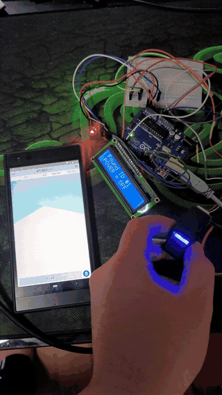
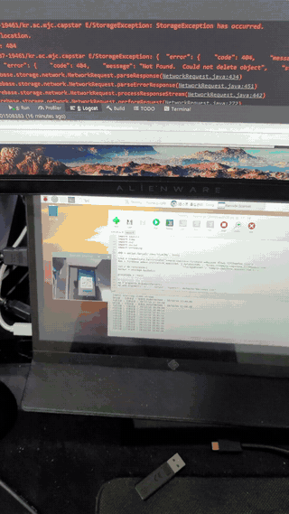
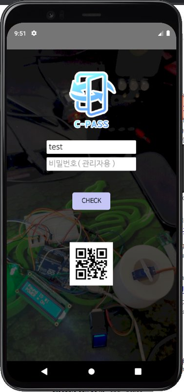
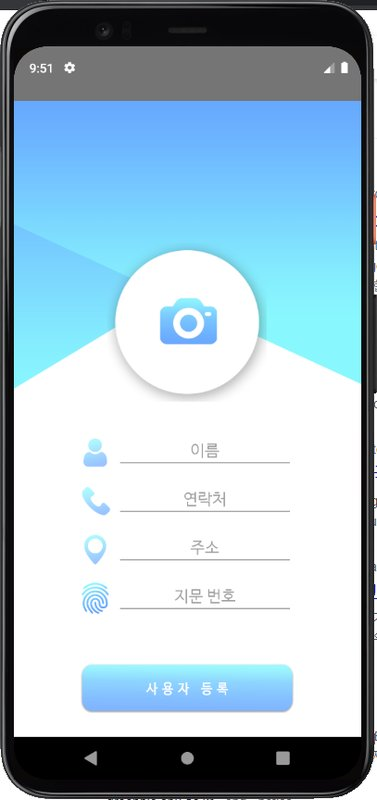
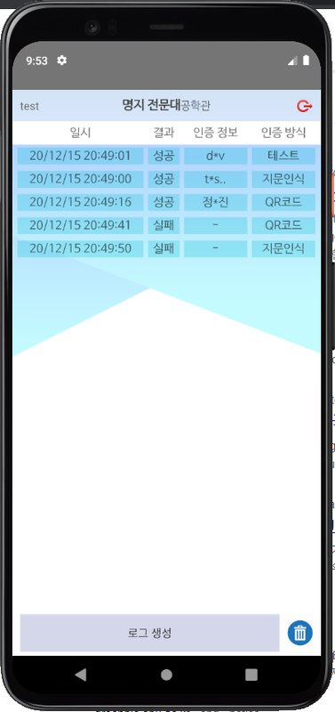
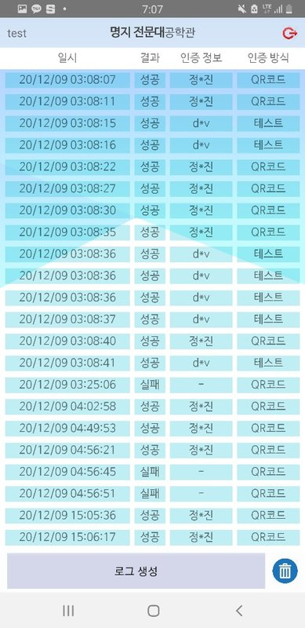
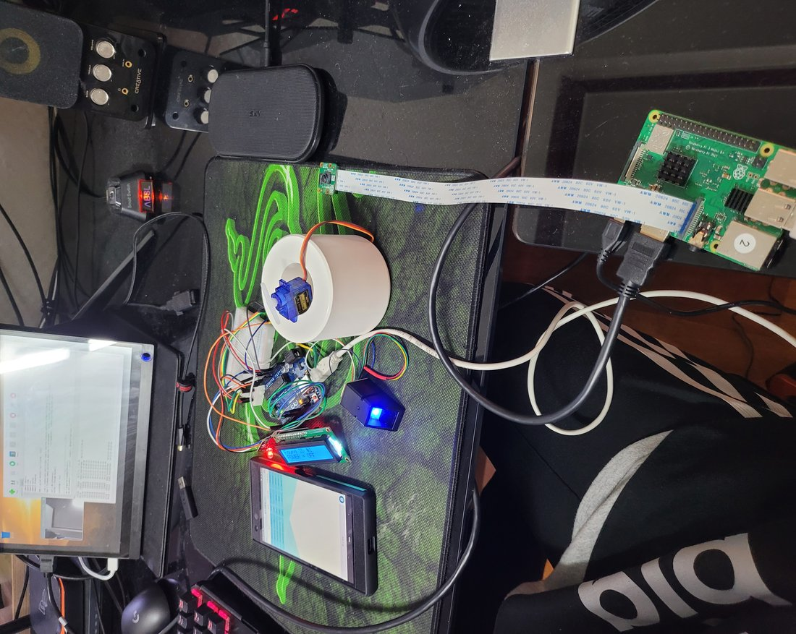
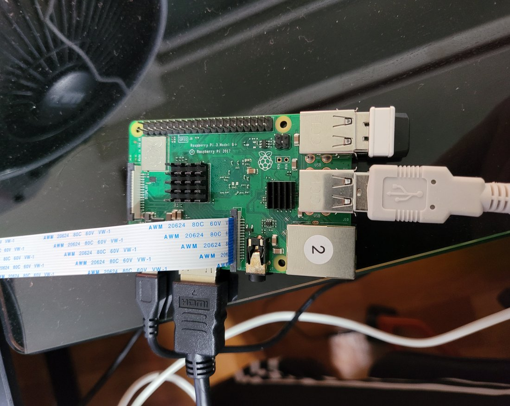
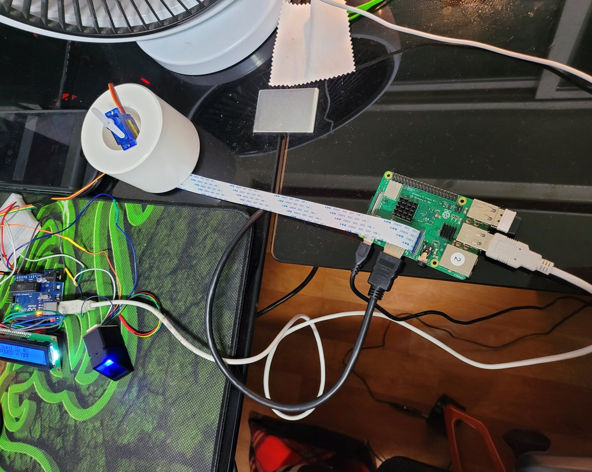
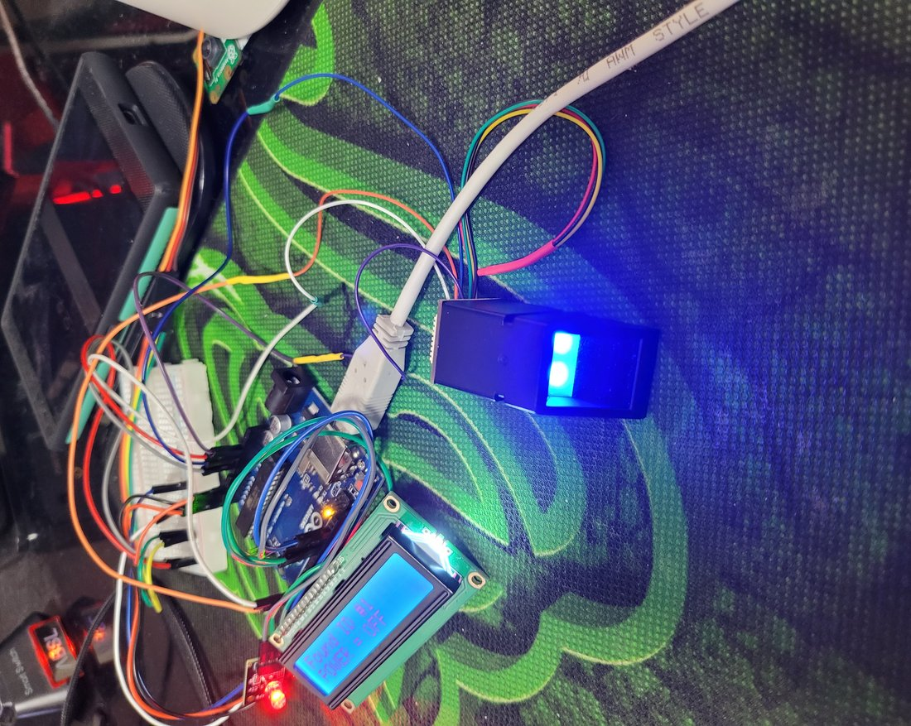

# 캡스타 (C-PASS) — 사물인터넷 기반 출입관리 시스템

**QR 코드와 지문으로 출입을 인증하고, 출입 기록을 실시간으로 관리하는 IoT 출입관리 시스템**입니다.
라즈베리파이 카메라가 스마트폰의 QR 코드를 읽거나, 아두이노 지문 센서가 등록된 지문을 확인하면 문(서보모터)이 열리고,
모든 출입 시도(성공/실패)가 Firebase에 기록되어 관리자 앱에서 바로 확인됩니다.

> 2020년 2학기 캡스톤디자인 팀 프로젝트(8명, 산업체 멘토 연계)입니다. 결과보고서와 시연 영상을 바탕으로 정리했습니다.

## 맡은 역할

QR 인증, 안드로이드 앱, Firebase DB, 지문 인식까지 **시스템 전 파트의 개발에 참여**했습니다.

| 파트 | 내용 |
|---|---|
| 라즈베리파이 QR 인증 | Pi 카메라 실시간 QR 인식(OpenCV·pyzbar), 등록 사용자 검증, 아두이노로 문 열기 명령, 출입 로그·QR 이미지 Firebase 저장 |
| 안드로이드 앱 (C-PASS) | 사용자 등록·QR 발급, 장소 코드 체크인, 관리자 로그 화면(RecyclerView), 자동 로그인 |
| Firebase DB 설계 | Realtime DB(장소별 User/Log), Storage(인증 QR 이미지), Authentication(관리자 계정) 구성 |
| 아두이노 지문 인식 | 지문 등록·인증, LCD 안내, LED·서보모터 문 제어, 라즈베리파이와 USB 시리얼 통신 |

## 시연

| 지문 인증 → 문 열림 | QR 인증 |
|:---:|:---:|
|  |  |

## 시스템 구성

```
 ┌────────────────────┐   QR 발급(이름·연락처·장소코드 JSON)
 │  C-PASS 앱 (사용자)  │ ───────────────────────────┐
 └────────────────────┘                             │ 화면의 QR을 카메라에 보여줌
                                                     ▼
 ┌────────────────────┐  USB 시리얼   ┌──────────────────────────┐
 │ 아두이노             │ ◀──────────▶ │ 라즈베리파이 (authQR.py)   │
 │ 지문센서·LCD·서보모터 │  'x' = 문 열기 │ Pi 카메라 + OpenCV/pyzbar │
 │                    │  'fo#ID' 지문성공│                          │
 └────────────────────┘  'fx' 지문실패  └────────────┬─────────────┘
                                                    │ 출입 로그 + 인증 QR 이미지
                                                    ▼
                                      ┌──────────────────────────┐
                                      │ Firebase                 │
                                      │ Realtime DB / Storage /  │
                                      │ Authentication           │
                                      └────────────┬─────────────┘
                                                   │ 실시간 구독
                                                   ▼
                                      ┌──────────────────────────┐
                                      │ C-PASS 앱 (관리자) 로그 화면 │
                                      └──────────────────────────┘
```

### 인증 흐름

- **QR 인증**: 사용자가 앱에서 이름·연락처·장소 코드·지문 번호를 등록하면 QR 코드가 발급됩니다. 라즈베리파이가 QR을 읽어 JSON을 파싱하고, 해당 장소의 등록 사용자와 일치하면 아두이노에 `x`를 보내 문을 엽니다.
- **지문 인증**: 아두이노가 지문을 인식하면 결과(`fo#지문ID` / `fx`)를 시리얼로 라즈베리파이에 보내고, 라즈베리파이가 지문 번호로 사용자를 찾아 로그를 남깁니다.
- 실패한 시도(등록되지 않은 QR, 형식이 잘못된 QR, 미등록 지문)도 모두 로그에 남습니다.

## 화면

### 안드로이드 앱 (C-PASS)

| 장소 코드 체크인 | 사용자 등록 · QR 발급 | 관리자 로그 화면 | 실제 기기 로그 |
|:---:|:---:|:---:|:---:|
|  |  |  |  |

- 장소 코드만 입력하면 장소 정보 팝업, 장소 코드 + 비밀번호를 입력하면 관리자 화면으로 체크인
- 관리자 로그: 일시 · 결과(성공/실패) · 인증 정보 · 인증 방식(QR/지문). 항목을 누르면 사용자 정보와 인증에 쓰인 QR 이미지 표시
- 로그 전체 삭제, 로그아웃, 자동 로그인 지원

### 하드웨어

| 전체 구성 | 라즈베리파이 + 카메라 모듈 |
|:---:|:---:|
|  |  |
| **라즈베리파이 ↔ 아두이노 USB 연결, 서보모터 문** | **지문 센서 · LCD** |
|  |  |

## 폴더 구조

```
android/            C-PASS 안드로이드 앱 (Java + Kotlin, Firebase)
arduino/
  enroll/             지문 등록 스케치 (Adafruit Fingerprint 예제 응용)
  fingerprint_door/   지문 인증 + LCD + LED + 서보모터 문 제어, 라즈베리파이 시리얼 통신
raspberry-pi/
  authQR.py           QR 실시간 인식, 사용자 검증, 아두이노 연동, Firebase 로그
docs/               README 이미지와 시연 GIF
```

## 실행

**라즈베리파이** (Raspbian, Python 3.7)
```bash
pip install opencv-python imutils pyzbar qrcode firebase-admin pyserial
export FIREBASE_KEY_PATH=/path/to/serviceAccountKey.json
export FIREBASE_DB_URL=https://<project-id>.firebaseio.com/
export FIREBASE_BUCKET=<project-id>.appspot.com
python3 raspberry-pi/authQR.py
```
아두이노는 `/dev/ttyACM1`, 9600bps로 연결합니다.

**아두이노**: `Adafruit Fingerprint Sensor`, `LiquidCrystal_I2C`, `Servo` 라이브러리 설치 후 업로드 (지문 센서 SoftwareSerial 2·3번, 서보 A2, LED 12·13번)

**안드로이드 앱**: Firebase 프로젝트를 만들고 내려받은 `google-services.json`을 `android/app/`에 넣은 뒤 Android Studio에서 빌드합니다.

> Firebase 서비스 계정 키와 `google-services.json`은 보안상 저장소에 포함하지 않았습니다.

## 알려진 한계 (당시 그대로 보존)

- 장소 코드가 `test`로 고정되어 있고, 사용자 일치 여부를 DB 목록을 문자열로 바꿔 포함 여부로 검사합니다.
- QR에 이름·연락처가 평문 JSON으로 들어가 있어, 실서비스라면 서명된 토큰으로 바꿔야 합니다.
- 시리얼 포트(`/dev/ttyACM1`)가 하드코딩되어 있습니다.
- 앱 로딩 화면 배경 GIF(`res/raw/ba.gif`)는 원본이 161MB라 GitHub 용량 제한 때문에 해상도를 줄여 넣었습니다.

## 참고 자료

- QR 인식: OpenCV, pyzbar 및 공개 블로그 예제 코드를 응용
- 지문 인식: Adafruit Fingerprint 라이브러리 예제를 응용

## 기술 스택

Raspberry Pi · Python · OpenCV · pyzbar · Arduino · Adafruit Fingerprint · Android (Java/Kotlin) · Firebase (Realtime DB, Storage, Auth)
